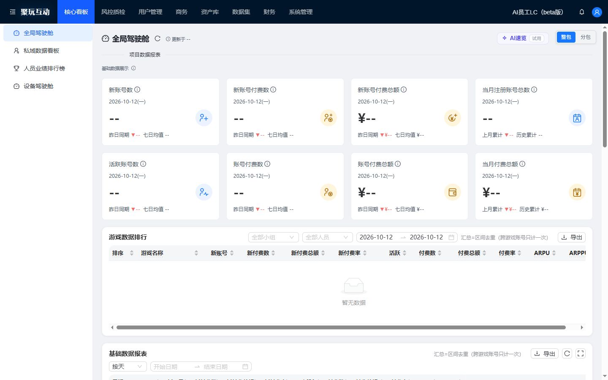
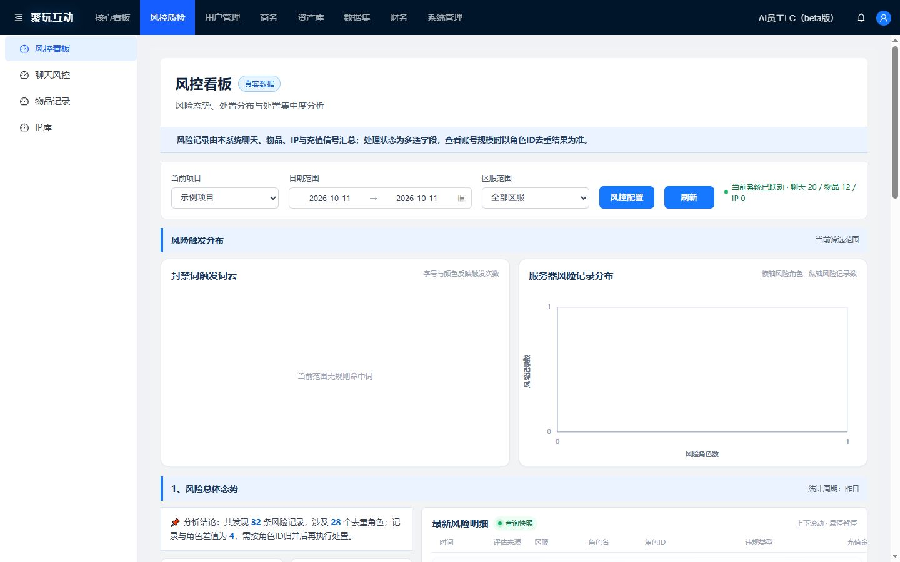

# 核心看板与风控看板 · Claude 交付入口

重点：全局驾驶舱 `/` 与风控看板 `/risk/quality`。本次通过独立分支交付，未部署生产。花名册视觉试点不在此分支中。

## 截图对照

浏览器运行当前组件与当前风控脚本；视口高度 900px。核心看板展示数据源不可用时的缺失状态；风控使用隔离的虚构项目与计数。没有真实员工、玩家或生产数据。基线和改后使用相同接口条件。

| 页面 | 宽度 | 改前 | 改后 |
| --- | --- | --- | --- |
| 全局驾驶舱 | 1440 | [改前](screenshots/core-before-1440.jpg) | [改后](screenshots/core-after-1440.jpg) |
| 全局驾驶舱 | 1280 | [改前](screenshots/core-before-1280.jpg) | [改后](screenshots/core-after-1280.jpg) |
| 全局驾驶舱 | 375 | [改前](screenshots/core-before-375.jpg) | [改后](screenshots/core-after-375.jpg) |
| 风控看板 | 1440 | [改前](screenshots/risk-before-1440.jpg) | [改后](screenshots/risk-after-1440.jpg) |
| 风控看板 | 1280 | [改前](screenshots/risk-before-1280.jpg) | [改后](screenshots/risk-after-1280.jpg) |
| 风控看板 | 375 | [改前](screenshots/risk-before-375.jpg) | [改后](screenshots/risk-after-375.jpg) |

补充：[风险指标和明细](screenshots/risk-overview-1440.jpg) · [等待查询](screenshots/risk-waiting-375.jpg) · [503 失败](screenshots/risk-error-375.jpg)

## 改动源码

- [DashboardPage.js](../../main-app/src/pages/DashboardPage.js)：指标卡标记、布局间距、手机单列、复用八个指标 SVG；数字计算、查询和事件处理不变。
- [focus-dashboard.css](../../main-app/src/styles/focus-dashboard.css)：仅作用于这两个看板的排版、表格滚动、筛选、导航与小屏布局。
- [index.html](../../main-app/index.html)：加载局部样式及现有主站鉴权脚本，复现正式服务的加载入口。
- [vite.config.js](../../main-app/vite.config.js)：开发与构建提供当前风控脚本的已有请求别名。
- [preview.mjs](../../scripts/preview.mjs)：主站预览选择主站鉴权资源，避免与管理端同名脚本冲突。

[源码补丁](source.patch) · [验证结果](验证结果.md) · [构建输出](build.log) · [源码检查](code-checks.json) · [预览检查](preview-checks.json) · [尺寸测量](viewport-results.json)

风控当前代码为 [risk-control-prototype.js](../../main-app/src/extensions/risk-control-prototype.js)，本次保持原样。历史 `risk-control-dashboard.js` 是另一份原型，不能据它评价当前风控页面。

## 给 Claude 的审核任务

请先查看这里的两页、六组前后截图及五个改动源码文件，再给出带截图位置或代码位置的意见。优先检查核心指标层级、数字可读性、桌面日期筛选不重叠、表头不无意义换行、手机导航可操作、主内容无横向溢出，以及风控的指标、图表、明细之间的层级。

范围只包含全局驾驶舱和风控看板；私域、人员排行、聊天风控明细等尚未推广。保持现有接口、权限、会话、统计口径、风险规则、手动查询规则和涨跌配色，不新增依赖，不将缺失数据改成零。八个指标图标沿用项目现有 SVG 设计。页面重建工程保留 JSX 运行时调用和 ES 模块实时绑定，修改时保持这些依赖。

运行：`npm run build --prefix main-app`，然后 `npm run preview`。后端须通过 `DC_API_TARGET` 明确接入已授权测试环境；默认 API 返回 JSON 503。截图用的虚构身份和接口仅在本机临时预览程序内，未加入产品源码。

请区分截图可确认的问题、需要真实数据的问题和推测。本次仅验证本地组件与展示，不代表生产业务验收。后续修改先说明影响范围和验收方式，由用户确认。
