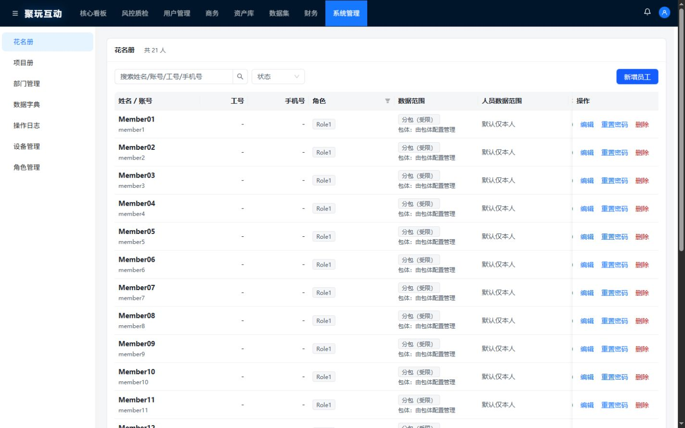

# 花名册视觉试点 · Claude 交付入口

本入口包含截图、可编辑源码、差异和验证结果。范围：管理端花名册及其弹窗，浅色模式。

## 前后截图

截图为浏览器运行实际组件的本地渲染，使用相同虚构员工数据。视口高度均为 900px；不是生产业务截图。

| 宽度 | 改前 | 改后 |
| --- | --- | --- |
| 1440px | [改前](screenshots/before-1440.jpg) | [改后](screenshots/after-1440.jpg) |
| 1280px | [改前](screenshots/before-1280.jpg) | [改后](screenshots/after-1280.jpg) |
| 375px | [改前](screenshots/before-375.jpg) | [改后](screenshots/after-375.jpg) |

[手机新增弹窗](screenshots/modal-375.jpg) · [空状态](screenshots/empty-375.jpg) · [骨架加载](screenshots/loading-375.jpg)

## 改动文件

- [SystemUsers.jsx](../../system-console/src/pages/SystemUsers.jsx)：筛选和主操作布局、范围合并展示、等宽数字、空状态与骨架、弹窗样式标记。
- [SystemUsers.css](../../system-console/src/pages/SystemUsers.css)：花名册局部样式，手机导航及表格滚动，弹窗间距。
- [theme.js](../../system-console/src/theme.js)：花名册局部 ConfigProvider 主题和颜色变量。

[完整源码补丁](source.patch) · [验证报告](验证结果.md) · [23 项检查结果](test-results.json) · [构建输出](build.log)

## 给 Claude 的审核任务

请读取本入口的三组截图、三个源码文件、源码补丁和验证结果，对照以下条件给出有截图位置或代码位置的反馈：三种宽度的布局与外层溢出、正文对比度至少 4.5:1、数字右对齐且等宽、标签含义一致、范围信息完整、空状态与加载态清晰。

仅审核花名册试点。主题只作用于花名册及其弹窗；颜色搜索只检查本次 JSX/CSS，颜色值集中在 theme.js。辅助文字使用可读深灰，装饰灰不用于正文。接口、权限、会话、查询规则与业务处理保持现状；不新增依赖，不推广其他页面。手机筛选允许换行，表格和导航内部滚动。浅色模式，不涉及经营指标涨跌配色。

请区分截图可确认的视觉问题、需要交互验证的问题和推测；本次没有生产业务写入验证。后续修改先给清单、影响范围和验收方式，等待用户确认。
